<p align="center">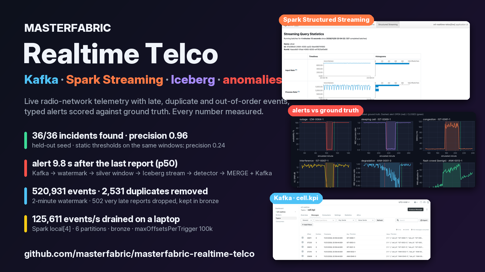</p>

# MasterFabric · Realtime Telco

**Streaming network monitoring for a mobile operator, small enough to run on one laptop.** A simulated
radio network sends 10-second KPI reports from 240 cells into Kafka, delivered the way real mediation
chains deliver: late, out of order and sometimes twice. Spark Structured Streaming turns them into
Iceberg tables (bronze, silver, gold) and a per-cell stateful detector raises typed alerts: outage,
sleeping cell, congestion, interference and slow degradation. Every alert is scored against the
ground truth that produced the telemetry.

All numbers below come from runs on an Apple M4 Pro (24 GB) with Docker through Colima
(6 vCPU, 10 GB). They are read from [`docs/results/`](docs/results) and none are estimates.

| | Measured |
|---|---|
| Live run | 240 cells · 6 simulated hours at 30x · **520,931 events** delivered in 12 minutes |
| Detection (held-out seed) | **36/36 incidents**, 45 alerts, **2 false** · precision **0.956** · recall **1.0** · type accuracy **1.0** |
| Static thresholds, same windows | 334 alerts, **253 false** · precision **0.243** · 35/36 found |
| Latency, last report → alert | p50 **9.8 s**, p95 9.8 s (Kafka → watermark → silver → Iceberg stream → detector → MERGE + Kafka) |
| Data handling | 2,531 duplicates removed · 502 very late rows dropped by the watermark (kept in bronze) · 0 parse failures |
| Throughput (drain) | bronze **125,611 events/s** · silver 74,689–94,561 events/s · Spark `local[4]`, 6 partitions |
| Table maintenance | silver 357 → 6 files · per-cell aggregate **736.9 → 43.5 ms** |

---

## Contents

[Why](#why-this-lab) · [Architecture](#architecture) · [The detector](#the-detector) ·
[Results](#results) · [Screenshots](#what-it-looks-like) · [Quickstart](#quickstart) ·
[Walkthrough](#walkthrough) · [Enterprise mapping](#enterprise-mapping) · [Decisions](#design-decisions) ·
[Limitations](#limitations) · [Roadmap](#roadmap) · [Build timeline](docs/TIMELINE.md) · [License](#license)

## Why this lab

A network operations centre (NOC) in a large operator watches tens of thousands of cells. Three things
make its alarms hard to get right:

1. **Normal is different for every cell and every hour.** A residential cell at 21:00 and a business
   district cell at 04:00 have nothing in common. A static threshold that fits one is noise for the other.
2. **Telemetry arrives imperfectly.** PM files are collected in cycles, mediation re-sends, and links
   delay data. A streaming system has to decide what "this minute" means and when it is complete.
3. **An alarm has to be explainable and typed.** A field engineer needs "interference on IST-0007-1, SINR
   down 9 dB" and not just "anomaly score 0.93".

This repository builds that pipeline end to end with open components, measures it, and documents the
decisions in [ADRs](docs/adr). It is the streaming companion to
[masterfabric-lakehouse-lab](https://github.com/masterfabric/masterfabric-lakehouse-lab), which covers
the batch side.

## Architecture

<p align="center">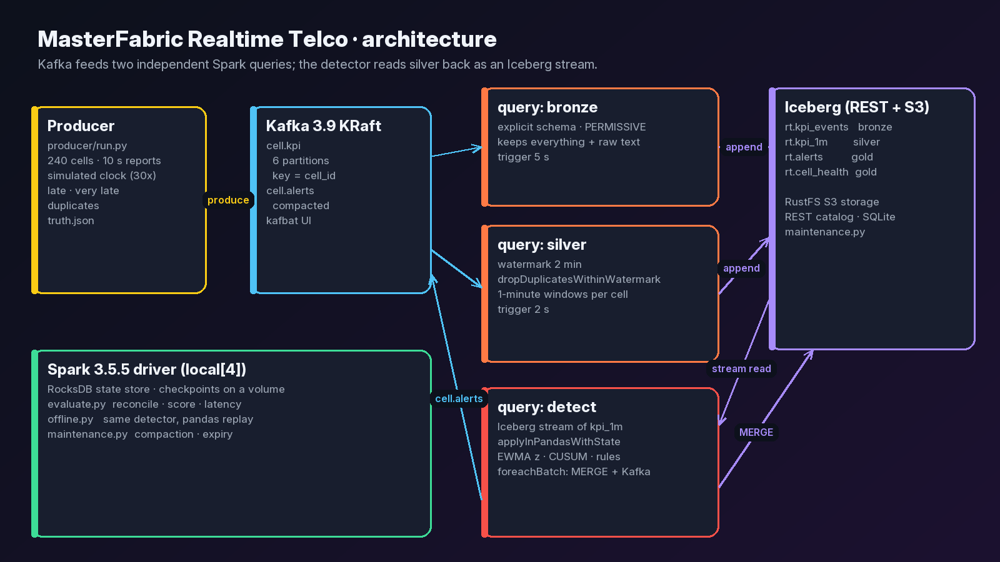</p>
<p align="center"><sub><b>Figure 1.</b> Kafka feeds two independent Spark queries (bronze, silver). The detector reads silver back as an Iceberg stream, so the contract between aggregation and detection is a table that any engine can query or replay.</sub></p>

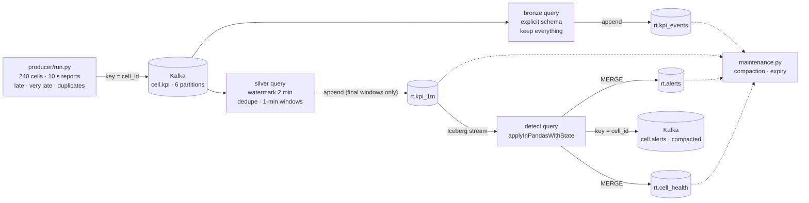

### What happens to one report

```mermaid
sequenceDiagram
  autonumber
  participant Cell as Cell IST-0007-1
  participant K as Kafka cell.kpi
  participant Br as bronze (5 s trigger)
  participant Si as silver (2 s trigger)
  participant De as detect (2 s trigger)
  participant Out as rt.alerts / cell.alerts
  Cell->>K: report 10:41:20 (arrives 35 s late)
  K->>Br: next micro-batch: parsed, appended with partition/offset
  K->>Si: dedupe on event_id, added to window 10:41
  Note over Si: window 10:41 stays open until<br/>watermark = max event time − 2 min passes 10:42
  Si->>De: window committed to rt.kpi_1m, read as an Iceberg stream
  De->>De: EWMA z-scores, CUSUM, rules; per-cell state in RocksDB
  De->>Out: OPEN interference (evidence JSON), MERGE + Kafka
```

The three queries have separate checkpoints. Bronze never waits for aggregation, and silver can be
rebuilt from Kafka (or from bronze) without touching raw capture. See
[ADR 0004](docs/adr/0004-iceberg-between-stages.md).

## The detector

<p align="center">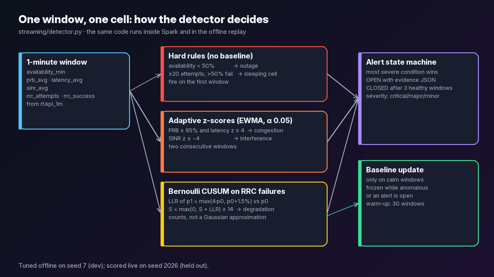</p>
<p align="center"><sub><b>Figure 2.</b> One finalised minute for one cell passes through hard rules, adaptive z-scores and a Bernoulli CUSUM. The most severe condition wins, and the baseline learns only from calm windows.</sub></p>

The detector ([`streaming/detector.py`](streaming/detector.py)) keeps a few floats per cell: EWMA mean
and variance of PRB, latency, SINR and RRC failure rate, a CUSUM statistic and the open alert. That
fits in Spark's `applyInPandasWithState` (240 state rows, 46 MiB in the live run) and runs unchanged
offline with pandas ([`streaming/offline.py`](streaming/offline.py)).

| Incident | Signature in the data | Rule | Windows needed |
|---|---|---|---|
| Outage | availability 0 | availability < 50% | 1 |
| Sleeping cell | reports itself up, almost all RRC setups fail | ≥ 20 attempts and > 50% fail | 1 |
| Congestion | PRB pinned at the ceiling, latency ×5 | PRB ≥ 95% **and** latency z ≥ 4 | 2 |
| Interference | UL SINR down ~9 dB, drops up | SINR z ≤ −4 against the cell's own baseline | 2 |
| Degradation | RRC failure rate drifts from 0.5% to ~9.5% over 30–60 min | Bernoulli CUSUM ≥ 14 nats | 1 |
| Flash crowd (benign) | a stadium site at 1.5× load | must **not** alert | n/a |

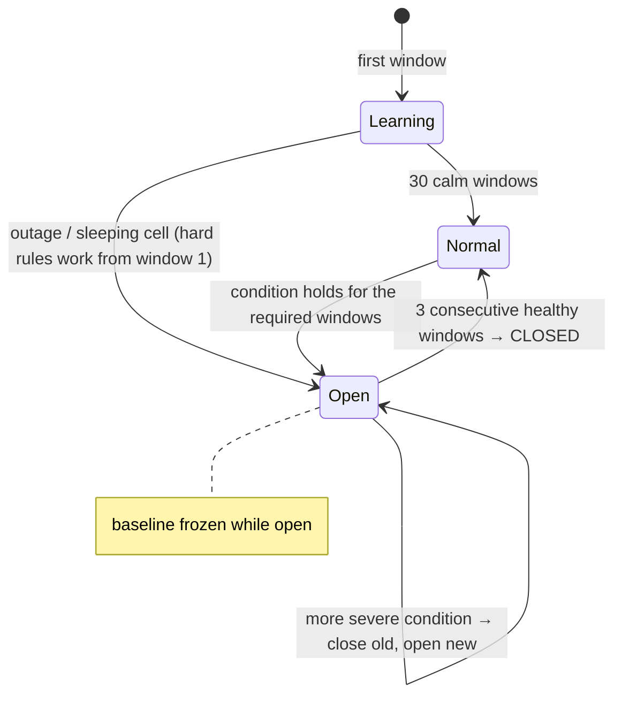

**Tuning and judging are separated.** Thresholds were chosen on a development seed (7) with the
offline replay, and the live pipeline was then scored on seed 2026, which was not used for tuning. Two
findings from that process are in the git history:

- A Gaussian z-score on the RRC failure rate produced **88 false alerts** on the development seed.
  Failures are small counts (about 0.5 per cell-minute), so the normal approximation is wrong. A
  Bernoulli log-likelihood CUSUM brought that to 1 at the same recall.
- The first live run found every incident but left **10 cells flagged as degraded** at the end: the
  uncapped CUSUM had climbed into the hundreds and needed hours to drain. Capping it at 1.5× the
  threshold fixed this (0 cells stuck), and detection did not change
  ([`live_run1_uncapped_cusum.json`](docs/results/live_run1_uncapped_cusum.json)).

<p align="center">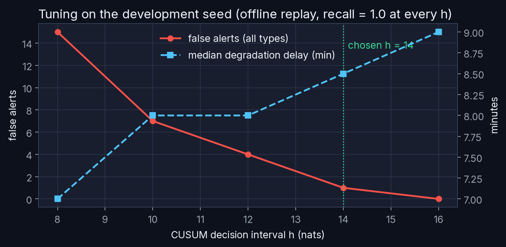</p>
<p align="center"><sub><b>Figure 3.</b> Development seed only: false alerts against the median degradation delay for each CUSUM threshold. Recall is 1.0 at every setting; h = 14 was chosen.</sub></p>

## Results

### Detection on the held-out seed

<p align="center">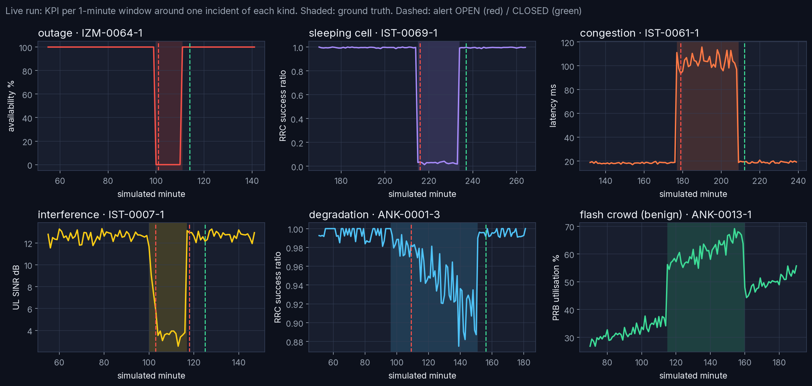</p>
<p align="center"><sub><b>Figure 4.</b> Real silver windows from the live run around one incident of each kind. Shaded: ground truth. Red dashed: alert opened. Green dashed: alert closed. The flash crowd (bottom right) raised no alert.</sub></p>

| Incident type | Incidents | Detected | Type correct | Median delay | Max delay |
|---|---:|---:|---:|---:|---:|
| Outage | 6 | 6 | 6 | 1.0 min | 1.0 min |
| Sleeping cell | 4 | 4 | 4 | 1.0 min | 1.0 min |
| Congestion | 5 | 5 | 5 | 2.0 min | 2.0 min |
| Interference | 7 | 7 | 7 | 3.0 min | 5.0 min |
| Degradation | 14 | 14 | 14 | 12.5 min | 24.0 min |
| **All** | **36** | **36** | **36** | **3.0 min** | p90 15.0 min |

Delays are in simulated minutes, from incident start to the end of the first alerting window. A
degradation starts invisibly small, so it takes longest to detect by design.

<p align="center">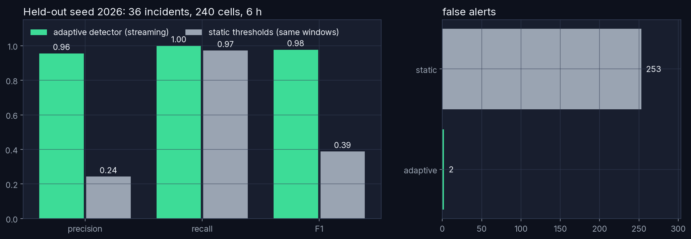</p>
<p align="center"><sub><b>Figure 5.</b> The same 85,680 silver windows through the adaptive detector and a static rule set (PRB > 85%, latency > 30 ms, SINR < 6 dB, RRC success < 97%). The static rules find almost as many incidents but bury them under 253 false alerts, mostly busy-but-healthy cells and cells whose normal SINR is low.</sub></p>

### Latency

<p align="center">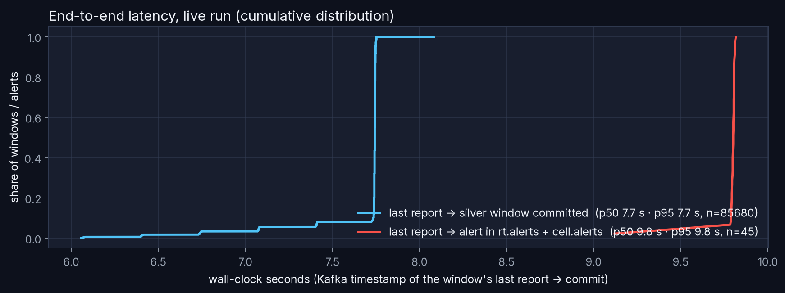</p>
<p align="center"><sub><b>Figure 6.</b> Wall-clock latency from the Kafka timestamp of a window's last report to the silver commit (85,680 windows) and to the alert (45 alerts).</sub></p>

| Hop | p50 | p95 | max |
|---|---:|---:|---:|
| Kafka → bronze row | 2.4 s | 4.7 s | 4.8 s |
| last report → silver window committed | 7.7 s | 7.7 s | 8.1 s |
| last report → alert in `rt.alerts` and `cell.alerts` | **9.8 s** | 9.8 s | 9.8 s |

Most of the silver latency is the watermark: a window is final only when event time has moved two
simulated minutes past it (4 s of wall time at 30×), plus a 2-second trigger. Both are settings, not limits.
In real time (1×), the watermark wait would be the full 2 minutes, which is the price of correctness
for late data ([ADR 0003](docs/adr/0003-event-time-watermarks.md)).

### Throughput and state

<p align="center">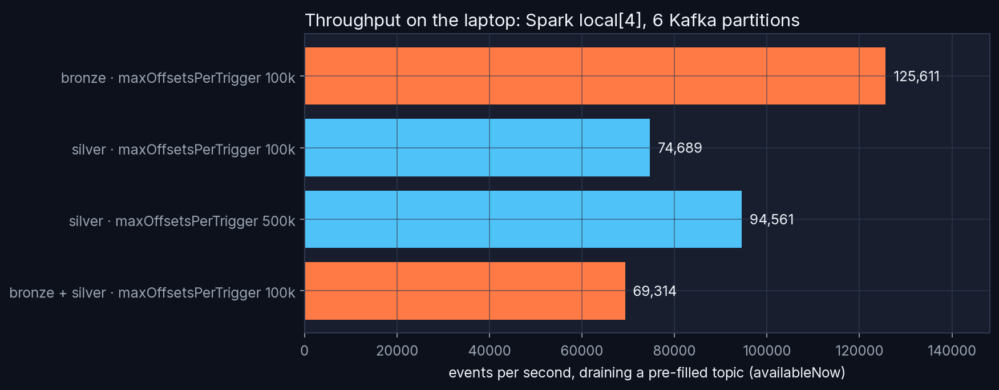</p>
<p align="center"><sub><b>Figure 7.</b> Draining a pre-filled topic of 1,042,065 events with availableNow triggers. Each configuration reads the whole topic, so "bronze + silver" processes every event twice.</sub></p>

| Configuration | Events | Batches | Seconds | Events/s | Largest batch |
|---|---:|---:|---:|---:|---:|
| bronze · maxOffsetsPerTrigger 100k | 1,042,065 | 11 | 8.30 | **125,611** | 2.3 s |
| silver · 100k | 1,042,065 | 11 | 13.95 | 74,689 | 3.0 s |
| silver · 500k | 1,042,065 | 3 | 11.02 | 94,561 | 4.8 s |
| bronze + silver · 100k | 1,042,065 | 22 | 15.03 | 69,314 | 3.2 s |

The live run needed about 724 events/s, so the laptop has roughly 100× headroom. Larger batches help
silver (fewer state store commits) at the cost of a longer worst-case batch. The Python producer
itself reached 88,540 events/s.

<p align="center">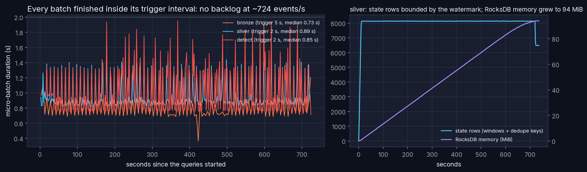</p>
<p align="center"><sub><b>Figure 8.</b> Live run, every micro-batch. Left: batch durations (median 0.73 s bronze, 0.89 s silver, 0.85 s detect) stay under the 2-second trigger, so no backlog builds. Right: silver state rows stay flat (bounded by the watermark) while RocksDB memory kept growing to 94 MiB over 12 minutes; see Limitations.</sub></p>

### Iceberg tables after a streaming run

Streaming commits every few seconds leave many small files and snapshots. Numbers before maintenance
come from the evaluation right after the run, and numbers after come from
[`maintenance_live.json`](docs/results/maintenance_live.json).

| Table | Data files | Snapshots | After maintenance |
|---|---:|---:|---|
| `rt.kpi_events` (bronze) | 167 | 146 | 6 files · 1 snapshot |
| `rt.kpi_1m` (silver) | 357 (15.3 KiB avg) | 363 | 6 files (354.6 KiB avg) · 1 snapshot |
| `rt.alerts` | 83 | 68 | 5 files · 1 snapshot |
| `rt.cell_health` | 32 | 68 | 1 file · 1 snapshot |

A per-cell aggregate over silver went from **736.9 ms to 43.5 ms** (median of 5) after compaction.

### Reconciliation

| Check | Count |
|---|---:|
| Producer reports / delivered (incl. re-sends) | 518,400 / 520,931 |
| Bronze rows / unique `event_id` | 520,931 / 518,400 |
| Duplicates removed in silver | 2,531 (= injected re-sends) |
| Silver windows / reports inside them | 85,680 / 513,579 |
| Not in silver | 4,821 = 502 very late rows dropped by the watermark + the last ~2 simulated minutes, which never close once input stops |

## What it looks like

<p align="center">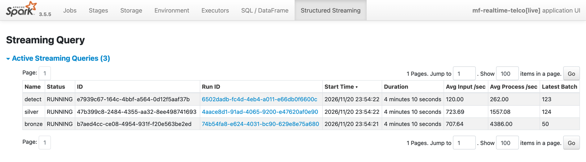</p>
<p align="center"><sub><b>Figure 9.</b> Spark UI during the live run: the three queries running side by side, about 724 input rows/s each for bronze and silver and 120 windows/s for the detector.</sub></p>

<p align="center">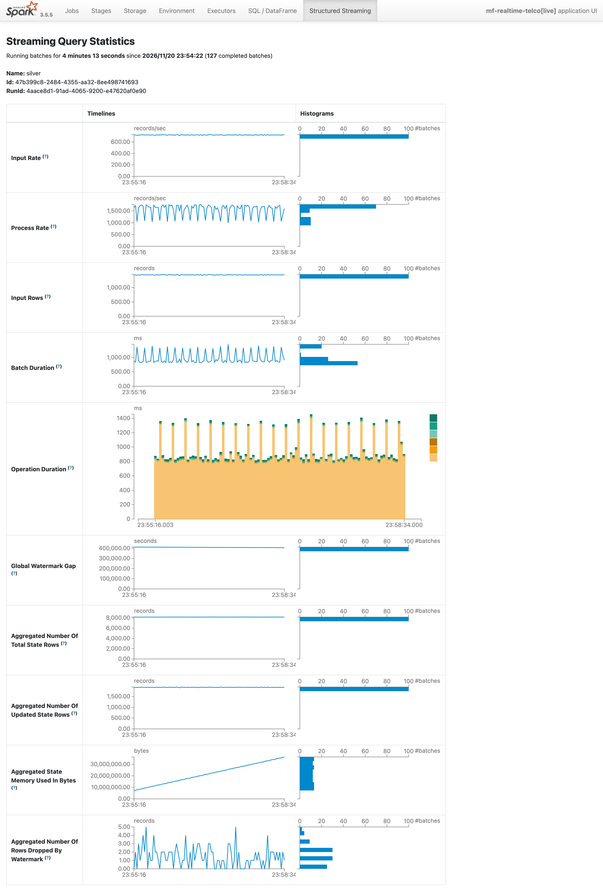</p>
<p align="center"><sub><b>Figure 10.</b> Silver query statistics: steady input rate, batch durations around 1 s, flat state rows, and a few rows per batch dropped by the watermark (the very late reports). The "global watermark gap" is large because event time is simulated (16 Nov) while the wall clock is real.</sub></p>

<p align="center">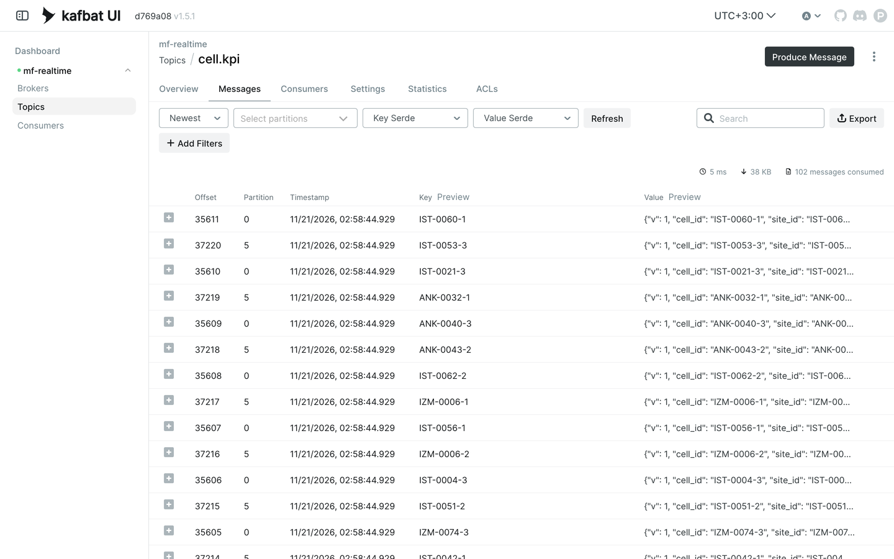</p>
<p align="center"><sub><b>Figure 11.</b> kafbat UI on <code>cell.kpi</code>: JSON payloads keyed by cell ID across six partitions.</sub></p>

<p align="center">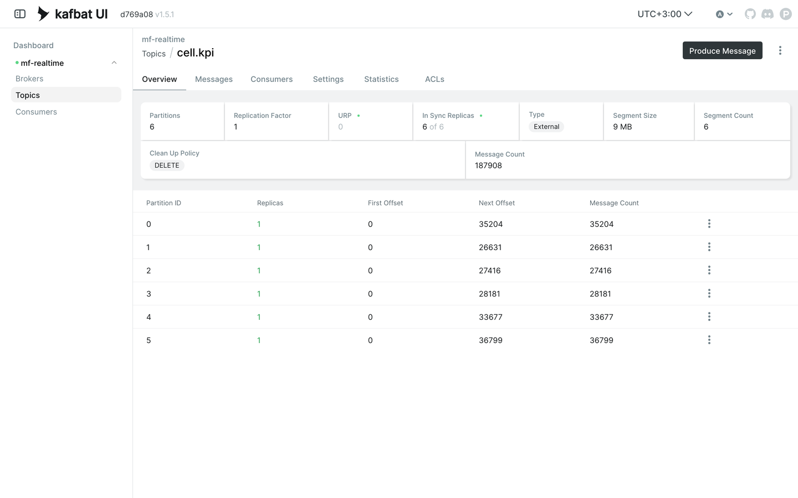</p>
<p align="center"><sub><b>Figure 12.</b> Partition sizes at the same moment ranged from 8,334 to 11,518 messages: keying by cell keeps per-cell order but follows the hash of the keys (<a href="docs/adr/0001-kafka-kraft-backbone.md">ADR 0001</a>).</sub></p>

<p align="center">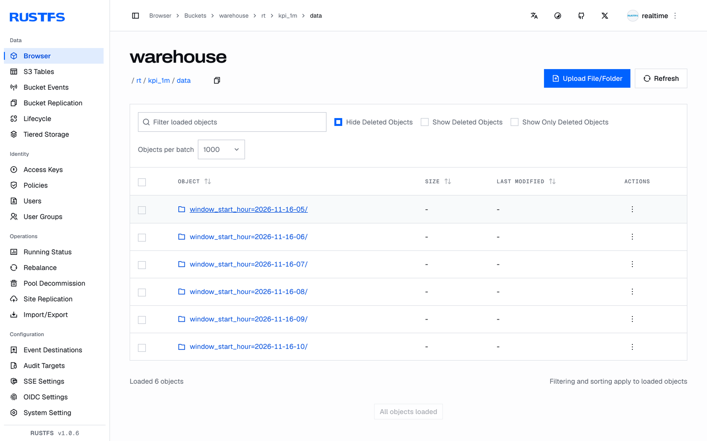</p>
<p align="center"><sub><b>Figure 13.</b> The silver table in object storage: Iceberg hidden partitioning by <code>hours(window_start)</code>, one folder per simulated hour.</sub></p>

## Quickstart

Requirements: Docker with Compose (Docker Desktop, Colima or OrbStack) and about 8 GB of memory for the
VM. For screenshots and charts you also need [uv](https://docs.astral.sh/uv/).

```bash
git clone https://github.com/masterfabric/masterfabric-realtime-telco.git
cd masterfabric-realtime-telco
make up          # Kafka, Kafka UI, RustFS, Iceberg REST catalog, Spark (builds the Spark image once)
make test-unit   # 20 producer/detector tests inside the Spark container
make live        # fresh topic, streaming app, 6 simulated hours at 30x (about 13 minutes)
make evaluate    # reconcile, score and time it into docs/results/live_live.json
```

| Service | URL (all bound to 127.0.0.1) |
|---|---|
| Kafka UI | http://127.0.0.1:28080 |
| Spark UI (streaming app, while running) | http://127.0.0.1:24040/StreamingQuery/ |
| Spark History | http://127.0.0.1:28090 |
| RustFS console | http://127.0.0.1:29001/rustfs/console/ (credentials in your local `.env`) |
| Kafka from the host | `127.0.0.1:29092` |

`make down` stops everything and keeps the volumes.

## Walkthrough

| Step | Command | What to look at |
|---|---|---|
| 1. Tune offline | `make offline SEED=7` | Same detector over a file dump with pandas; CUSUM sweep in `docs/results/offline_dev_seed7.json` |
| 2. Run live | `make live` | Spark UI Structured Streaming tab; Kafka UI topic `cell.kpi`, then `cell.alerts` |
| 3. Score it | `make evaluate` | precision/recall per incident type, latency per hop, reconciliation |
| 4. Maintain | `make maintain` | small files and snapshots before and after, probe query speed-up |
| 5. Benchmark | `make bench` | drain throughput in four configurations |
| 6. Visuals | `make tools assets` and `make screenshots MODE=live` while step 2 runs | everything under `docs/images` and `docs/screenshots` |

Producer knobs: `CELLS`, `HOURS`, `SPEED`, `--late-rate`, `--very-late-rate`, `--duplicate-rate`,
`--incidents-per-cell-hour`. Streaming knobs: `--watermark-min`, `--trigger-*`, `--max-offsets`.

```text
producer/    network model, KPI telemetry, Kafka producer with imperfect delivery + ground truth
streaming/   app.py (3 queries) · detector.py · schema.py · tables.py · evaluate.py · offline.py · maintenance.py
scripts/     live_run.sh · bench.sh · screenshots, diagrams, charts, hero
docker/      compose.yaml · Spark image (Iceberg + Kafka connector) · topic and bucket init
docs/        adr/ · results/ · images/ · screenshots/ · TIMELINE.md
tests/unit/  producer and detector tests
```

## Enterprise mapping

<p align="center">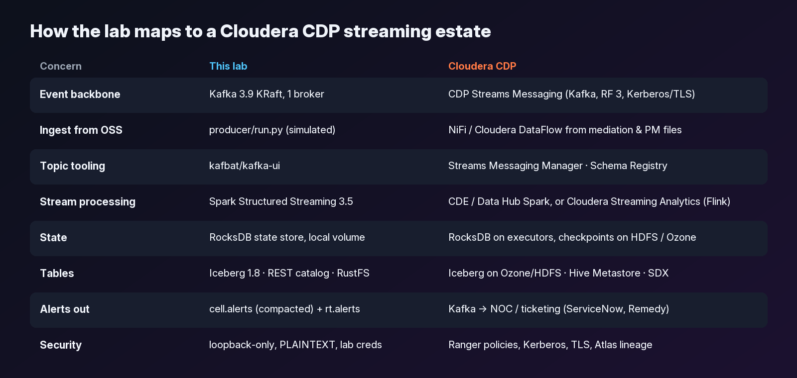</p>
<p align="center"><sub><b>Figure 14.</b> Each lab component and its counterpart in a Cloudera CDP streaming estate.</sub></p>

The patterns carry over unchanged: keyed topics, event-time windows with a watermark, dedupe within the
watermark, independent queries per sink, an Iceberg table as the hand-off between streaming stages,
idempotent `MERGE` in `foreachBatch`, and scheduled compaction. What changes at scale is operational:
RF 3 with Kerberos/TLS, Ranger policies, checkpoints on HDFS/Ozone, a schema registry, and executors
on YARN or Kubernetes instead of `local[4]`.

## Design decisions

| ADR | Decision |
|---|---|
| [0001](docs/adr/0001-kafka-kraft-backbone.md) | Kafka in KRaft mode as the event backbone, keyed by cell |
| [0002](docs/adr/0002-spark-structured-streaming.md) | Spark Structured Streaming rather than Flink for this lab |
| [0003](docs/adr/0003-event-time-watermarks.md) | Event time, a 2-minute watermark and dedupe within the watermark |
| [0004](docs/adr/0004-iceberg-between-stages.md) | Iceberg tables, not topics, as the hand-off between streaming stages |
| [0005](docs/adr/0005-adaptive-detector.md) | Per-cell adaptive baselines and a Bernoulli CUSUM instead of a trained model |
| [0006](docs/adr/0006-exactly-once-effects.md) | Exactly-once effects: checkpoints, idempotent MERGE, keyed at-least-once alerts |
| [0007](docs/adr/0007-payload-contract.md) | JSON with an explicit schema contract; Avro/Protobuf + registry in production |

## Limitations

These are deliberate simplifications or measured weaknesses, listed so the numbers above are read correctly.

- **Synthetic network.** Incidents are clean, labelled and single-cell. Real networks have correlated
  failures (a site power cut, a transport link, a core outage), maintenance windows and counter resets.
  The detector's precision and recall here are an upper bound.
- **Alert flapping during long degradations.** The 14 degradation incidents produced 23 alert openings:
  the capped CUSUM can dip under the threshold for three windows mid-incident and re-open. All count as
  true alerts, but a NOC would see them as noise. Hysteresis (close only below half the threshold) is
  the next change.
- **Simulated clock.** Event time runs 30× faster than wall time, so watermark waits and detection delays
  in wall seconds are 30× shorter than they would be in production. Delays are reported in simulated
  minutes where it matters. At 120× (the smoke test) a 5-second trigger spanned 10 simulated minutes and
  even "very late" reports made it into windows, which is why the live run uses 30× and 2-second triggers.
- **RocksDB memory grew** to 94 MiB over the 12-minute run while state rows stayed flat. It was not
  investigated further. A long-running job should set
  `spark.sql.streaming.stateStore.rocksdb.boundedMemoryUsage` and watch it.
- **Single broker, PLAINTEXT, local checkpoints.** Kafka has replication factor 1 and no authentication.
  Checkpoints are on a Docker volume (79 MiB after the live run), and the catalog uses `ResolvingFileIO`
  so the Iceberg streaming source can keep its offsets there. Production needs RF 3, TLS/SASL and
  checkpoints on HDFS or S3.
- **Spark, not Flink.** Micro-batches give second-level latency. That is fine for NOC alarms and wrong for
  sub-second use cases ([ADR 0002](docs/adr/0002-spark-structured-streaming.md)).
- **Object storage is RustFS, not MinIO.** The MinIO images could not be pulled from this machine
  (Docker Hub returned "access denied", quay.io 401). RustFS speaks the same S3 API.
- **The tail of a run is not scored.** Windows in the last two simulated minutes never close once input
  stops, so incidents starting there are excluded.
- **The Spark Thrift server** started by the base image holds port 4040. The streaming UI is on 4041
  (host 24040).

## Roadmap

- Alert hysteresis and suppression of child alerts under a site-level parent (correlated failures).
- A learned component next to the rules: an isolation forest on silver windows, trained and registered
  through the MLOps lab, judged with the same scorer.
- Flink SQL implementation of the silver stage to compare latency and state size on the same feed.
- Avro + schema registry, and a dead-letter topic for payloads that fail the contract.
- Multi-broker Kafka with TLS in Compose, and the detector's state TTL for decommissioned cells.

## License

Copyright © 2026 MasterFabric. Licensed under the **GNU Affero General Public License v3.0**; see
[LICENSE](LICENSE). Third-party components keep their own licenses (Apache Kafka, Apache Spark and
Apache Iceberg under Apache-2.0, RustFS under Apache-2.0, kafbat/kafka-ui under Apache-2.0); see
[NOTICE](NOTICE). Apache®, Apache Kafka®, Apache Spark® and Apache Iceberg® are trademarks of the Apache
Software Foundation; Cloudera and CDP are trademarks of Cloudera, Inc. No endorsement is implied. All
telemetry in this repository is synthetic.
